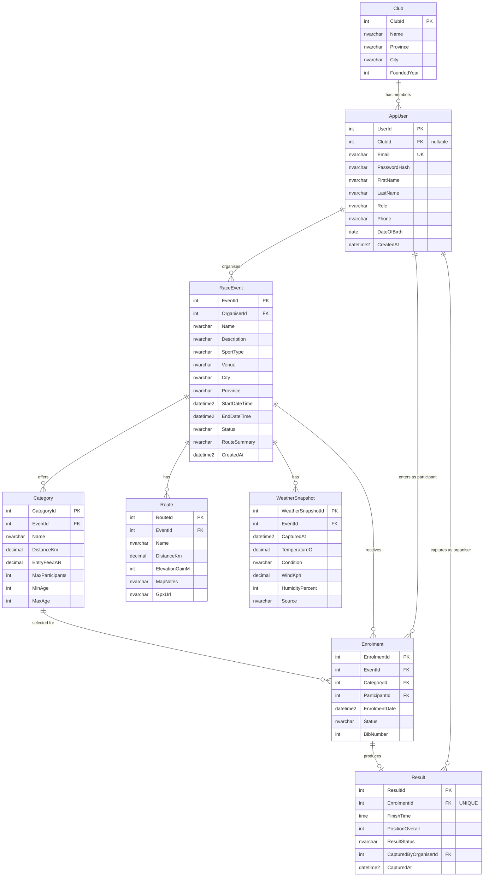

# RaceDay Entity Relationship Diagram (Part 1)

**Module:** PROG6212 – Programming 2B  
**System:** RaceDay  
**Format:** Crow’s-foot logical model. This document is the source of truth for cardinality. Export or screenshot this diagram as `docs/erd.png` if a PNG is required for ARC.

The physical schema in `RaceDay.sql` uses the **same eight entity names, attributes, keys and relationships**. There is **no deliberate difference** between this ERD and the SQL script.

## Crow’s-foot overview

## Cardinality (written form)

| Relationship | Cardinality | Rationale |
|---|---|---|
| Club → AppUser | 1 : 0..* | A club can have many members; a user may join without a club (`ClubId` nullable). |
| AppUser → RaceEvent | 1 : 0..* | One organiser creates many events. |
| RaceEvent → Category | 1 : 1..* | Every event must offer at least one distance/category (seed data always includes categories). |
| RaceEvent → Route | 1 : 0..* | Route files/notes support race-day preparation (later Azure Blob in Part 3). |
| RaceEvent → WeatherSnapshot | 1 : 0..* | Live/cached weather snapshots for race-day preparation. |
| AppUser → Enrolment | 1 : 0..* | A participant may enter many events. |
| RaceEvent → Enrolment | 1 : 0..* | An event receives many entries. |
| Category → Enrolment | 1 : 0..* | Participants choose one category when they enter. |
| Enrolment → Result | 1 : 0..1 | At most one official result per enrolment. |

**Many-to-many:** Participant and RaceEvent are resolved through **Enrolment** (associative entity), not a direct M:N link.

## Keys

- **PK** columns are underlined in the diagram labels (`ClubId`, `UserId`, `EventId`, `CategoryId`, `RouteId`, `WeatherSnapshotId`, `EnrolmentId`, `ResultId`).
- **FK** columns: `AppUser.ClubId`, `RaceEvent.OrganiserId`, `Category.EventId`, `Route.EventId`, `WeatherSnapshot.EventId`, `Enrolment.EventId`, `Enrolment.CategoryId`, `Enrolment.ParticipantId`, `Result.EnrolmentId`, `Result.CapturedByOrganiserId`.
- **Alternate keys:** `AppUser.Email` UNIQUE; `Enrolment (EventId, ParticipantId)` UNIQUE; `Result.EnrolmentId` UNIQUE.

## Why eight entities (exceeds the minimum of six)

Six entities would cover users, events, categories, enrolments, results and one extra table. RaceDay adds **Club**, **Route** and **WeatherSnapshot** so the model already supports South African club culture, route information, and live weather — all stated in the project brief — before API code is written in Part 2.
